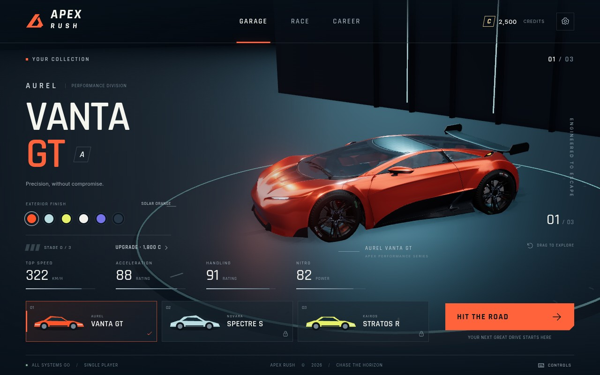

# APEX RUSH

A complete, independent single-player browser arcade racer: pick a car, choose a circuit, race, earn credits, upgrade your garage, and play again. Inspired by the excitement of premium arcade racing, with original game design and properly licensed assets. This is not an Asphalt product and does not claim Asphalt 9 production quality.

## Play online or download

[Play in your browser](https://jawwadahmedhusaini.github.io/Racing-game/preview/) · [Download the playable preview](https://jawwadahmedhusaini.github.io/Racing-game/preview/APEX-RUSH.zip)

[Download editable source and tests](https://github.com/jawwadahmedhusaini/Racing-game/archive/refs/heads/apex-32-neon-pit-bay.zip) · [Audit response and remaining targets](AUDIT_RESPONSE.md)

The next free-asset upgrade is tracked in [ASSET_UPGRADE_PLAN.md](ASSET_UPGRADE_PLAN.md), including verified candidate findings, blocked downloads and the offline GLB inspection command. Version 2.5 imports a CC0 BMW M3 community model and credited CC BY engine/impact samples from Stunt Rally. The other shortlisted manufacturer models still need usable source archives and licensing evidence.

The online link requires the repository's GitHub Pages deployment to be enabled; see [HOSTING.md](HOSTING.md). If your browser still shows the previous build, refresh the page. Version 2.4 adds the independently authored **Solstice GT** (2,500 credits), six AI opponents, traffic-aware passing, controlled drift recovery, acceleration/landing camera response, a reduced-motion option, circuit braking references and event dressing. Engine firing profiles now vary by car and gears use hysteresis. Credits, cars, paints and upgrades carry forward; new race records are separate from prior handling versions.

Version **2.4.1** fixes sudden slowdown after boost, head-on/reverse contact response, close-finish timing, elimination standings and keyboard navigation. Older records remain saved; corrected handling uses separate v4 records. See [DEEP_AUDIT.md](DEEP_AUDIT.md) for reproduced defects, validation and remaining limits.



## New in 3.2 — Neon Harbor pit bay

The full-screen pit bay features the BMW M3 GTR with updated paint, wheels, brake calipers, and lamps. Open **Vehicles** to choose any of the eight cars, or **Tune** for paint, audio preview, and performance upgrades. **Race Neon Harbor Sprint** goes straight to a one-lap race against six rivals. The race adds braking boards and apex markings through the freight chicane and keeps a separate sprint record. Existing selections and saved progress carry forward.

## New in 3.1 — Studio garage

The garage has a dedicated 3D viewing area and a make-and-model roster. All cars are available during this preview, and the game remembers the selected car without changing ownership or charging credits. The Ferrari 575 GTC–derived Cavallo 575 GTC joins the BMW M3 GTR and the rest of the roster. See [asset credits](ASSET_LICENSES.md).

## New in 3.0 — Neon Harbor

Aurel Orion R is the new starter and featured car. It uses original geometry, four independently rigged wheels, suspension response, functional lamps and a separate race LOD. The rebuilt 3.19 km Neon Harbor circuit links the docks, a container chicane, a lit underpass and an elevated waterfront return. The title uses a frame from the running race, and the new circuit briefing leads directly into the grid.

Existing cars, selections, progress and previous lap records carry forward. The rebuilt route writes to the separate `city-v8-*` record keys. **Continue** restores the last regular race setup.

## New in 2.7 — Imported cars and architecture

The LF GT adds an independent community car by MasterLife, textured body/cockpit, animated wheels, functional lamps and a 33,532-triangle race LOD. It costs 4,500 earned credits and uses the existing layered V12 sound bank. Neon Harbor now includes four artist-authored building designs by raytrace with adapted Calinou surfaces, distinct glazing and room lighting. The architecture pack loads only when preparing the city. Existing vehicles, circuits, credits and records remain available. See [IMPORTED_ART_UPGRADE.md](IMPORTED_ART_UPGRADE.md) for measured scope and limits.

## New in 2.6 — Neon Harbor and vehicle loading

Neon Harbor has a new 2.71 km route, exposed waterfront, port cranes and cargo, illuminated street frontage and an elevated return. Vehicle models load on demand with shared requests, retry and an eviction cache that protects live instances. Existing cars and saves remain; new times use v7 records. See [upgrade scope and remaining targets](NEON_HARBOR_UPGRADE.md).

## Fixed in 2.5.2 — collision response

Corner impacts now turn the car's body with damped yaw response. Wall friction penalizes grinding, the speedometer includes sideways motion, and rivals look farther ahead when braking for traffic. Previous progress is retained; revised handling uses v6 records. [Collision details](COLLISION_FIXES.md).

## Fixed in 2.5.1 — ramp edges

Cars straddling the ramp now climb and jump without getting stuck. Raised-side and rear impacts preserve movement along/away from the obstacle, including reverse escape. Full approaches are covered for every car on both circuits. [Ramp fix details](RAMP_FIXES.md).

## New in 2.5 — sound and contact

- Four sampled engine characters (V8, V12, inline-six and touring V8), five RPM layers per bank, load-sensitive filtering, shifts, overrun, tire/brake feedback, metal impacts, barrier scrape and landing sounds. Two nearby rivals use stereo placement and bounded Doppler. **Hear the engine** in the garage auditions the viewed car.
- **BMW M3 GTR community model** by Neubi, adapted by CryHam and APEX RUSH: 2,200 credits, independent body/interior and wheel geometry, functional lights, paint and race LOD. No manufacturer endorsement, exact specifications or authentic BMW recording is claimed.
- 120 Hz contact substeps, lateral collision recoil, angle-sensitive barrier response, tire grip recovery, reduced air steering and preserved horizontal jump momentum. Airborne braking cannot stop the car. Wall strikes invalidate clean-landing rewards.
- Existing cars, circuits and progression remain; revised handling uses v5 records. [Sound and collision release notes](SOUND_AND_CONTACT.md) explain the implementation and remaining limits.

## Play and develop

For the packaged release, unzip the downloaded `APEX-RUSH.zip` (local builds produce `artifacts/apex-rush-web.zip`), then run `START-WINDOWS.bat` on Windows or `python3 start-game.py` on macOS/Linux. Python 3 is the only launcher prerequisite; the launcher opens the game in your browser. Keep its terminal window open while playing. The release includes all game assets and needs no internet connection after download.

To run the editable source:

Requires Node.js 22.12+ (Node 24 tested) and a modern browser with WebGL 2 and hardware acceleration.

```sh
npm ci
npm run dev
```

Open the local address printed by Vite in your browser. The development server uses port 5173. No account, backend, API key or paid service is required. All game assets and fonts are served locally; gameplay makes no external requests.

For a production build:

```sh
npm run build
npm run preview
```

The complete static game is in `dist/`. Serve the contents of that directory with any HTTP server. Do not double-click `index.html`: browser security restrictions require HTTP for the model and modules. If you have Python, `python3 -m http.server 8000 --directory dist` serves the build. For GitHub Pages at `/Racing-game/`, use `npm run build:pages` and the activation steps in [HOSTING.md](HOSTING.md). Models and other assets respect the configured hosting base path.

## Included

- Reflective 3D garage with imported BMW M3 and LF community models, an original long-bonnet grand tourer and three tuned concept-car variants, six paint finishes, unlocks and three upgrade levels.
- A professionally authored, licensed car chassis with a modeled cockpit, treaded tires, animated wheels, lights and original aero packages.
- Costa Aurelia: a coastal circuit with elevation, bridges, palms, ridged terrain and textured hills, 3D vegetation, ocean shading and a captured coastal reflection environment.
- Neon Harbor: a waterfront city circuit with three facade families, stepped towers, recessed lit rooms, streetlights, headlights and damp asphalt.
- Detailed player car on Medium/High/Ultra, LED rear lights, clearcoat paint, fitted rear vents, high-quality contact shading and multisample antialiasing.
- Static filtered reflection probes for the garage and each track, plus spatial scenery culling and distance-based tree detail.
- Four rendering presets; High/Ultra enable ambient occlusion and restrained bloom.
- Seven-driver quick races (player plus six opponents), solo time attack, elimination races and a four-event career.
- Fixed-step arcade dynamics with manual heading-based steering, braking, reverse, drift slip and gradual grip recovery, nitro, shockwave, contact, jumps and recovery.
- Live rivals with speed planning, lane choice, overtaking, boost and collision responses.
- Countdown, lap progress, minimap, position, speed, timer, results, rewards and replay.
- Locally bundled sampled engine/metal-impact banks, synthesized tire/wind/boost detail, countdown and background music.
- Keyboard and touch input, pause/resume, three chase-camera distances, a reduced-motion setting, quality presets and audio controls.
- Validated browser-local progress, settings, best times and purchases.

## Controls

| Action | Keyboard |
| --- | --- |
| Accelerate | W / Up |
| Brake, then reverse | Hold S / Down after stopping |
| Steer | A, D / Left, Right |
| Drift | Hold Space while steering |
| Nitro | Shift |
| Change chase camera | C |
| Recover to the road center | R |
| Pause / resume | Escape |

Brake before bends and steer through them: holding forward alone no longer turns the car. Left/right match the chase-camera view. Drifting and clean landings recharge nitro. Activate boost with a full meter for a shockwave. The outside lane has a marked ramp: drive up it slowly or launch off its lip at speed. Hold brake for 0.35 seconds after stopping to reverse, up to 36 km/h. Accelerate to stop reversing and drive forward. The reverse camera widens without flipping the controls. Auto-acceleration is optional in Settings. Touch controls, including BRAKE / REV and RECOVER, appear on touch devices; landscape gives the best view. Brake overrides auto-acceleration and nitro. Holding nitro before launch activates it once you gain enough speed; release an empty boost to recharge.

Progress belongs to the current browser profile and origin. Clearing site data clears progress. No cloud synchronization is implemented.

## Validation

```sh
npm test
npm run test:e2e
npm run build
```

Browser tests use system Chromium at `/usr/bin/chromium`. Set `CHROMIUM_PATH` to another Chromium executable if necessary. The test configuration uses SwiftShader for reproducible headless WebGL; it is not a hardware-GPU performance benchmark. Browser tests combine real keyboard/touch events with a development-only fixed-step time-advance hook to complete races without waiting in real time. That hook is removed from production builds.

For a steadier view, enable **Reduced Camera Motion** in Settings. This removes camera shake/roll and forward nitro FOV surges. It does not change handling.

See [TEST_REPORT.md](TEST_REPORT.md), [PERFORMANCE_REPORT.md](PERFORMANCE_REPORT.md), [ARCHITECTURE.md](ARCHITECTURE.md), [ASSET_LICENSES.md](ASSET_LICENSES.md), [ROADMAP.md](ROADMAP.md) and [BUG_TRACKER.md](BUG_TRACKER.md).

After building, run `python3 scripts/package-release.py` to produce the browser release and editable source archives in `artifacts/`. The package includes an HTTP launcher because browser modules and 3D assets need a server.

## Scope

This release provides the complete single-player play loop. Reflection probes are captured once per scene; they do not update with moving cars or provide ray tracing. Vanta, Spectre and Stratos derive from a licensed concept chassis. Solstice is separately authored original geometry with a long bonnet, rearward cabin, its own lights and wheel assemblies; its detailed and race meshes contain 65,844 and 24,436 triangles. The garage has six choices across four underlying vehicle designs, including BMW M3 and LF community models. Spectre has a longer front body and rearward cabin; Stratos has wider fenders and a lower cabin. The authored body and glass normals follow these surface changes, while wheel assemblies remain rigid. Aero, performance and progression also differ. The BMW is an unofficial community recreation; LF uses its creator’s source label; Vanta, Spectre, Stratos and Solstice are fictional game names. The physics use a track-relative coordinate system with a manually controlled world heading. Forward input does not auto-steer; only rivals use a course-following controller. This is an arcade model with barriers, not a full rigid-body simulator. Multiplayer, branded car collections, photorealistic crash deformation, barrel-roll stunts, a large licensed soundtrack and a major-studio-sized career are not implemented.

## Tuning for your device

Open Settings and enable Performance Display to see measured FPS, approximate frame time and actual render resolution. Adaptive Resolution is enabled by default; it reduces image resolution after sustained slow frames and restores it gradually when there is headroom. It keeps your chosen effects preset. Disable it for fixed-resolution screenshots. If FPS remains low at the minimum resolution, choose Medium or Low to reduce geometry, shadows and effects.

One active tab per browser profile is allowed on HTTPS and localhost, preventing competing sessions from overwriting credits. Close the original tab and reload the new one to switch. Progress remains local to the browser and site address; the downloaded game and hosted site do not share a save. Browser storage failures are reported in-game.

See [DEVICE_TESTING.md](DEVICE_TESTING.md) for the outstanding physical-device checks and a repeatable test route.
