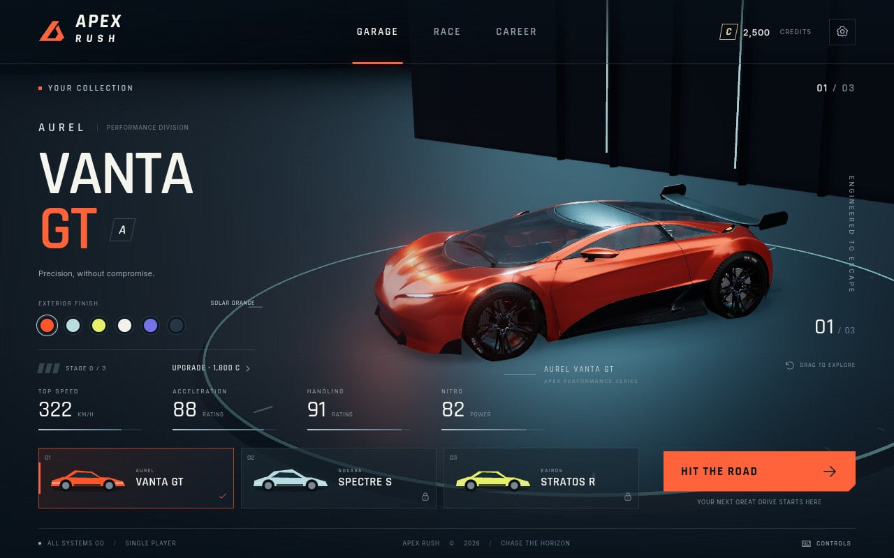

# APEX RUSH

A complete, independent single-player browser arcade racer: pick a car, choose a circuit, race, earn credits, upgrade your garage, and play again. Inspired by the excitement of premium arcade racing, with original game design and properly licensed assets. This is not an Asphalt product and does not claim Asphalt 9 production quality.

## Play online or download

[Play in your browser](https://jawwadahmedhusaini.github.io/Racing-game/) · [Download APEX RUSH 2.3](https://github.com/jawwadahmedhusaini/Racing-game/raw/refs/heads/main/downloads/APEX-RUSH.zip)

The online link requires the repository's GitHub Pages deployment to be enabled; see [HOSTING.md](HOSTING.md). If your browser still shows the previous build, refresh the page. Version 2.3 adds staged, cancellable race preparation; cached vehicle geometry; proper brake-to-reverse driving; a clearer starting straight; widened closing bends; and whole-circuit scenery clearance. Ramps now have a matching physical surface and solid raised edges. Existing credits, cars, upgrades and manual steering are preserved; revised circuits have separate lap records.



## Play and develop

For the packaged release, unzip `artifacts/apex-rush-web.zip`, then run `START-WINDOWS.bat` on Windows or `python3 start-game.py` on macOS/Linux. Python 3 is the only launcher prerequisite; the launcher opens the game in your browser. Keep its terminal window open while playing. The release includes all game assets and needs no internet connection after download.

To run the editable source:

Requires Node.js 22.12+ (Node 24 tested) and a modern browser with WebGL 2 and hardware acceleration.

```sh
npm ci
npm run dev
```

Open the local address printed by Vite in your browser. The development server uses port 5173. No account, backend, API key or paid service is required. All game assets and fonts are served locally; gameplay makes no external requests.

For a production build:

```sh
npm run build
npm run preview
```

The complete static game is in `dist/`. Serve the contents of that directory with any HTTP server. Do not double-click `index.html`: browser security restrictions require HTTP for the model and modules. If you have Python, `python3 -m http.server 8000 --directory dist` serves the build. For GitHub Pages at `/Racing-game/`, use `npm run build:pages` and the activation steps in [HOSTING.md](HOSTING.md). Models and other assets respect the configured hosting base path.

## Included

- Reflective 3D garage with three tuned concept-car variants, six paint finishes, unlocks and three upgrade levels.
- A professionally authored, licensed car chassis with a modeled cockpit, treaded tires, animated wheels, lights and original aero packages.
- Costa Aurelia: a coastal circuit with elevation, bridges, palms, ridged terrain and textured hills, 3D vegetation, ocean shading and a captured coastal reflection environment.
- Neon Harbor: a waterfront city circuit with three facade families, stepped towers, recessed lit rooms, streetlights, headlights and damp asphalt.
- Detailed player car on Medium/High/Ultra, LED rear lights, clearcoat paint, fitted rear vents, high-quality contact shading and multisample antialiasing.
- Static filtered reflection probes for the garage and each track, plus spatial scenery culling and distance-based tree detail.
- Four rendering presets; High/Ultra enable ambient occlusion and restrained bloom.
- Six-driver quick races, solo time attack, elimination races and a four-event career.
- Fixed-step arcade dynamics with manual heading-based steering, braking, reverse, drifting, nitro, shockwave, contact, jumps and recovery.
- Live rivals with speed planning, lane choice, overtaking, boost and collision responses.
- Countdown, lap progress, minimap, position, speed, timer, results, rewards and replay.
- Synthesized engine, tire, wind, boost, collision, countdown and background music.
- Keyboard and touch input, pause/resume, three chase-camera distances, quality presets and audio controls.
- Validated browser-local progress, settings, best times and purchases.

## Controls

| Action | Keyboard |
| --- | --- |
| Accelerate | W / Up |
| Brake, then reverse | Hold S / Down after stopping |
| Steer | A, D / Left, Right |
| Drift | Hold Space while steering |
| Nitro | Shift |
| Change chase camera | C |
| Recover to the road center | R |
| Pause / resume | Escape |

Brake before bends and steer through them: holding forward alone no longer turns the car. Left/right match the chase-camera view. Drifting and clean landings recharge nitro. Activate boost with a full meter for a shockwave. The outside lane has a marked ramp: drive up it slowly or launch off its lip at speed. Hold brake for 0.35 seconds after stopping to reverse, up to 36 km/h. Accelerate to stop reversing and drive forward. The reverse camera widens without flipping the controls. Auto-acceleration is optional in Settings. Touch controls, including BRAKE / REV and RECOVER, appear on touch devices; landscape gives the best view. Brake overrides auto-acceleration and nitro. Holding nitro before launch activates it once you gain enough speed; release an empty boost to recharge.

Progress belongs to the current browser profile and origin. Clearing site data clears progress. No cloud synchronization is implemented.

## Validation

```sh
npm test
npm run test:e2e
npm run build
```

Browser tests use system Chromium at `/usr/bin/chromium`. Set `CHROMIUM_PATH` to another Chromium executable if necessary. The test configuration uses SwiftShader for reproducible headless WebGL; it is not a hardware-GPU performance benchmark. Browser tests combine real keyboard/touch events with a development-only fixed-step time-advance hook to complete races without waiting in real time. That hook is removed from production builds.

See [TEST_REPORT.md](TEST_REPORT.md), [PERFORMANCE_REPORT.md](PERFORMANCE_REPORT.md), [ARCHITECTURE.md](ARCHITECTURE.md), [ASSET_LICENSES.md](ASSET_LICENSES.md), [ROADMAP.md](ROADMAP.md) and [BUG_TRACKER.md](BUG_TRACKER.md).

After building, run `python3 scripts/package-release.py` to produce the browser release and editable source archives in `artifacts/`. The package includes an HTTP launcher because browser modules and 3D assets need a server.

## Scope

This release provides the complete single-player play loop. Reflection probes are captured once per scene; they do not update with moving cars or provide ray tracing. The three cars derive from a licensed concept chassis. Spectre has a longer front body and rearward cabin; Stratos has wider fenders and a lower cabin. The authored body and glass normals follow these surface changes, while wheel assemblies remain rigid. Aero, performance and progression also differ. They are not three separately licensed manufacturer vehicles. The physics use a track-relative coordinate system with a manually controlled world heading. Forward input does not auto-steer; only rivals use a course-following controller. This is an arcade model with barriers, not a full rigid-body simulator. Multiplayer, branded car collections, photorealistic crash deformation, barrel-roll stunts, a large licensed soundtrack and a major-studio-sized career are not implemented.

## Tuning for your device

Open Settings and enable Performance Display to see measured FPS, approximate frame time and actual render resolution. Adaptive Resolution is enabled by default; it reduces image resolution after sustained slow frames and restores it gradually when there is headroom. It keeps your chosen effects preset. Disable it for fixed-resolution screenshots. If FPS remains low at the minimum resolution, choose Medium or Low to reduce geometry, shadows and effects.

One active tab per browser profile is allowed on HTTPS and localhost, preventing competing sessions from overwriting credits. Close the original tab and reload the new one to switch. Progress remains local to the browser and site address; the downloaded game and hosted site do not share a save. Browser storage failures are reported in-game.

See [DEVICE_TESTING.md](DEVICE_TESTING.md) for the outstanding physical-device checks and a repeatable test route.
